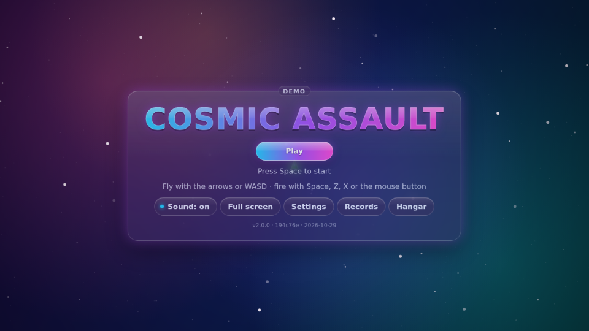
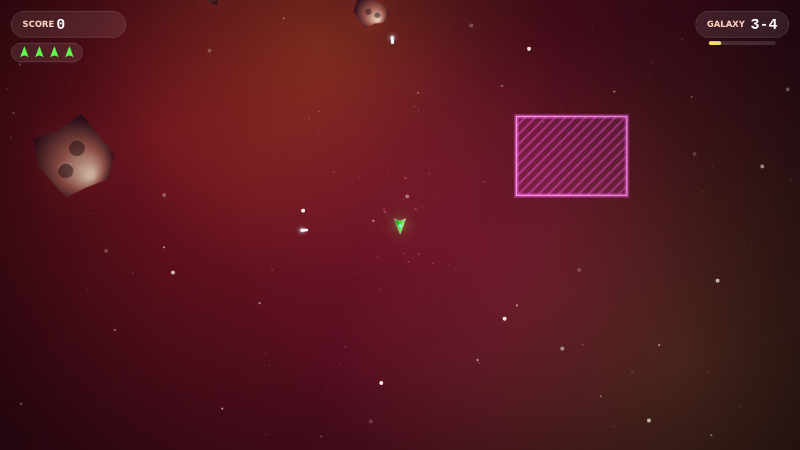
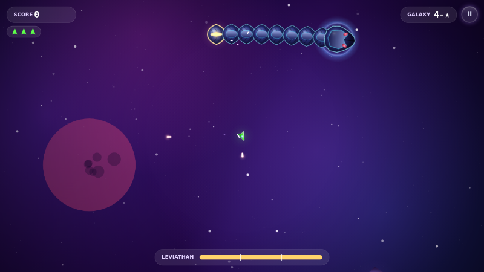
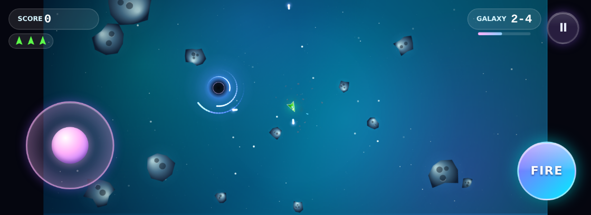

<p align="center">
  
</p>

<p align="center">
  <b>Steer, thrust and blast your way through neon rock fields, right in your browser, on desktop or phone.</b>
</p>

<p align="center">
  <a href="#-launch">🚀 Launch</a> ·
  <a href="#-controls">🎮 Controls</a> ·
  <a href="#-features">✨ Features</a> ·
  <a href="#-the-five-dimensions">🌌 The five Dimensions</a> ·
  <a href="#-modes">🏆 Modes</a> ·
  <a href="#%EF%B8%8F-behind-the-hangar">🛠️ Behind the hangar</a> ·
  <a href="#-license">📜 License</a>
</p>

<p align="center">
  
  
  
  
</p>

> [!TIP]
> **New in 2.0:** Cosmic Assault is rebuilt from the ground up. Fly five Dimensions of six galaxies each, with a boss
> at the end of every Dimension. Meet new foes, hazards and pickups, climb the Rank campaign, revisit any galaxy you
> have opened in Free play, take on a new Daily Galaxy every day, and unlock ship looks in the Hangar. It installs as an
> app, plays offline, and takes a gamepad. The ship handles just as it always has.

## 🚀 Launch

- **Play online:** <https://jpvelasco.github.io/cosmic-assault/>
- **Install it as an app:** on Android (and in desktop Chrome or Edge), tap **Install** on the title screen or use the
  browser's install button. On iPhone or iPad, open the game in Safari, tap **Share**, then **Add to Home Screen**.
- **Play offline:** after one visit the game is kept on your device, so it starts and plays without a connection.
- **Run locally** (Node.js 24, the version in [`.nvmrc`](.nvmrc)):

  ```bash
  cd game && npm ci && npm run dev
  ```

  Then open `http://localhost:5173`. No accounts or cloud setup are needed.

## 🎮 Controls

**Keyboard**

| Action | Control |
| --- | --- |
| Turn | `←` `→` or `A` `D` |
| Thrust | `↑` or `W` |
| Fire | `Space`, `Shift`, `Z` or `X`, or hold the left mouse button |
| Pause | `Esc` or `P`, or the **II** pause button at the top right |
| Mute | `M` |
| Full screen | `F` |
| Retry | `R` on the results or game-over card |
| Menus | Arrow keys move, `Enter` chooses, `Esc` goes back |

**Touch**

| Action | Control |
| --- | --- |
| Steer and thrust | The joystick: push the way you want to fly |
| Fire | The **FIRE** button |
| Pause | The **II** pause button, top right |
| Left-handed layout | **Settings → Left-handed controls** swaps the joystick and **FIRE** |

**Gamepad**

| Action | Control |
| --- | --- |
| Steer and thrust | The left stick, like the joystick, or the D-pad to turn and thrust |
| Fire | `A`, `RB` or `RT` |
| Pause | `Start` |
| Menus | The D-pad moves, `A` chooses, `B` goes back |

Phones play in landscape; the game asks you to rotate if you hold it upright.

> **Tip:** some keyboards drop a key while two arrow keys are held (keyboard ghosting). Fly with **WASD + Space**, or
> keep the arrows and fire with **Z**, **X**, **Shift** or the mouse button. The title screen names them too.

## ✨ Features

- 🌌 **Thirty galaxies in five Dimensions**, each Dimension with its own colours, sky and music. Survive a galaxy's
  timer to warp out; the sixth galaxy of each Dimension is a boss fight.
- 👾 **Five bosses** with phases and attacks you can learn: every attack winds up with a visible tell before it can hurt you.
- 🛸 **New foes** that split, swarm, strafe, blink and shrug off shots from the wrong side.
- 🌀 **Hazards** that pull, push, strike and teleport: each one shows a harmless warning before it turns hostile.
- 🛡️ **Eleven pickups**, from Shield and Spread Laser to Homing Missiles, a Wingman drone, Time Warp and the
  field-clearing Nova. Weapon Cores widen your volley.
- ☄️ **Meteor showers** arrive on schedule, announced by arrows at the edge of the screen.
- ⭐ **Stars** for every galaxy: one for surviving, two for losing at most one life, three for losing none.
- 🎨 **Ship looks:** skins and engine trails unlocked by the stars you win. They change the look, never the handling.
- 🎬 **An attract demo:** leave the title screen alone and a pilot flies a galaxy behind it.
- 📱 **Desktop and phone alike:** the same field and hitboxes everywhere, with bigger sprites on small screens.
- ⚙️ **Settings** for music and effects volume, screen shake and the touch layout. Screen shake follows your system's
  reduced-motion setting unless you choose otherwise.
- 🔊 **Synthesized sound and music**, generated live with the Web Audio API.
- 💾 **Progress saved** in this browser. Played the classic game here? Your old high score shows in Records as
  *Classic best*.

## 🌌 The five Dimensions

| Dimension | New foes | Hazards | New pickups | Boss |
| --- | --- | --- | --- | --- |
| 1 · The Drift | Splitters, which break into fast fragments | None | Weapon Core, Double Shot, Shield | **Monolith**: a rock core wrapped in orbiting shards you chip away |
| 2 · Ion Reach | Drones, which chase in small swarms | Gravity wells | Rapid Fire, Spread Laser | **Hive Carrier**: launches drone waves; its open hangar is the weak point |
| 3 · Crimson Nebula | Gunships, which fire telegraphed bolts, and mines | Danger zones | Piercing Beam, Homing Missiles | **Warden**: a turning ring of turrets with two gaps to fly through |
| 4 · Void Rift | Phasers, which blink in after a warning flash, and armoured rocks with one soft side | Repulsion fields, warp rifts | Field Bomb, Wingman | **Leviathan**: a serpent you take apart segment by segment |
| 5 · Singularity | Everything, mixed | A black hole at the centre that pulls on everything | Nova, Time Warp | **Eclipse**: a finale that remixes the other bosses' moves |

Survival galaxies run from 90 seconds in the Drift to 150 in the Singularity. Difficulty follows the galaxy you are
in, not your score, and each galaxy builds, eases off and surges on a set script.

## 🏆 Modes

- **Rank:** one campaign from the first galaxy to the last boss. Score, lives and your weapon carry from galaxy to
  galaxy. You start with three lives and win one back for each boss, up to five, and a death costs a weapon tier. The
  run saves between galaxies, so you can stop and pick it up later. *Continue* keeps you going after a game over but
  sets the score back to zero. Your best ten runs are kept in **Records**.
- **Free play:** play any galaxy you have opened, with three lives, for its best score and stars. Clearing a galaxy
  opens the next, and a boss opens the next Dimension.
- **Daily Galaxy:** a new galaxy every day, the same for everyone on that date, with one twist (more meteor showers,
  a gravity storm, a drone swarm or a field of splitters) and a target score to beat. Clear it on consecutive days to
  build a streak.
- **The Hangar:** pick your ship's skin and engine trail from the looks your stars have unlocked.

## 🛠️ Behind the hangar

| Path | What lives there |
| --- | --- |
| `game/` | The game: TypeScript, Vite, Canvas 2D and Web Audio, with its tests |
| `.github/` | Workflows, issue templates and contributor docs |
| `docs/assets/` | README artwork: the banner and the screenshots |

**Tests.** The game logic runs as a deterministic simulation, apart from drawing and sound, which makes it testable to
the step. Vitest covers it with unit tests, and the ship's handling is checked against traces recorded from the classic
game. Headless bot pilots fly every galaxy over many seeds to hold each one to its difficulty targets, and Playwright
plays the built game in desktop and phone Chromium, through keyboard, touch and gamepad input. From `game/`:

```bash
npm ci
npm run lint && npm run typecheck && npm test
npx playwright install chromium && npm run test:e2e
```

**CI.** Every pull request to `main` runs the game's lint, typecheck, unit tests and Playwright suites, and checks that
the release build carries no test hooks and is laid out as the site. A performance job holds frame times to set
ceilings under a slowed-down CPU, and the bot balance suites report on every Dimension and the Daily.

**Deploy.** GitHub Pages is the only home. Each push to `main` that passes the game and performance jobs publishes the
release build, `game/dist/`, as the whole site.

Looking for the classic game? It lives on at the [`v1.0.0`](https://github.com/jpvelasco/cosmic-assault/tree/v1.0.0) tag.

Working on the code? Start with [`AGENTS.md`](AGENTS.md) and [`.github/CONTRIBUTING.md`](.github/CONTRIBUTING.md).
Changes are listed in [`CHANGELOG.md`](CHANGELOG.md).

## 📜 License

Released under the [MIT License](LICENSE).

---

<p align="center">Built with Canvas, Web Audio and too much coffee ☕</p>
