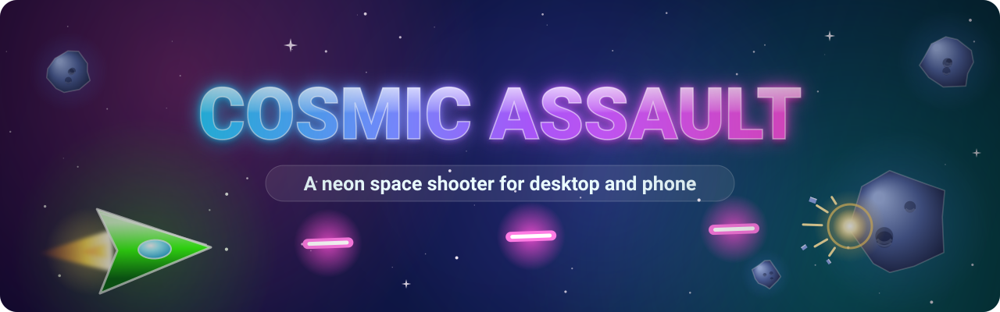

<p align="center">
  
</p>

<p align="center">
  <b>Steer, thrust and blast your way through neon rock fields, right in your browser, on desktop or phone.</b>
</p>

<p align="center">
  <a href="#-launch">🚀 Launch</a> ·
  <a href="#-controls">🎮 Controls</a> ·
  <a href="#-features">✨ Features</a> ·
  <a href="#-how-it-plays">🌌 How it plays</a> ·
  <a href="#%EF%B8%8F-behind-the-hangar">🛠️ Behind the hangar</a> ·
  <a href="#-license">📜 License</a>
</p>

## 🚀 Launch

- **Play online:** <https://jpvelasco.github.io/cosmic-assault/>
- **On iPhone or iPad:** open the game in Safari, tap **Share**, then **Add to Home Screen** for a full-screen launch from your home screen.
- **Run locally** (Node.js 20 or newer):

  ```bash
  cd tests && npm ci && npm run serve
  ```

  Then open `http://localhost:8080`. No accounts or cloud setup are needed.

## 🎮 Controls

**Desktop**

| Action | Control |
| --- | --- |
| Turn | `←` `→` or `A` `D` |
| Thrust | `↑` or `W` |
| Fire | `Space`, `Shift`, `Z` or `X`, or hold the left mouse button |
| Pause | `Esc` or `P`, or the **II** pause button at the top right |
| Start | Press a key (for example `Space`) on the title screen |
| Restart | `R` after game over |

**Touch**

| Action | Control |
| --- | --- |
| Steer and thrust | Virtual joystick: push the way you want to fly |
| Fire | **FIRE** button |
| Pause | **II** button at the top right |
| Start | Tap the screen |
| Restart | **RESTART** button after game over |

Phones play in landscape; the game asks you to rotate if you hold it upright.

> **Tip:** some keyboards drop `Space` while two arrow keys are held (keyboard ghosting). Fly with **WASD + Space**, or keep the arrows and fire with **Z**, **X** or the mouse button. The title screen names them too.

## ✨ Features

- 🛡️ **Power-ups** drop from shattered rocks: **Shield**, **Double Shot**, **Rapid Fire** and **Field Bomb**, which blasts away the rocks around you.
- 🔫 **Weapon upgrades** widen your spread as your score climbs.
- 🌀 **Gravity wells and repulsion fields** pull and push your ship, your shots and the rocks.
- ⚠️ **Danger zones** flash a warning, then cost you a life if you fly into them.
- ☄️ **Meteor showers** rain fast rocks down the screen.
- 🎯 **Bonus rounds** fill the sky with targets worth multiplied points.
- 💥 **Particle effects and screen shake** on every hit and blast.
- 🔊 **Synthesized sound**, generated live with the Web Audio API.
- 🏆 **High score** saved in this browser on this device, so it persists across reloads.

## 🌌 How it plays

- You start with three lives. Shots split rocks into two smaller, faster pieces, and smaller rocks are worth more: 20, 50, 100 and 150 points.
- Your score unlocks new levels at 5,000, 15,000, 30,000 points and beyond. Each level adds 0.4× to your score multiplier and sends more, faster rocks.
- Weapon upgrades arrive at 8,000 and 25,000 points, adding a shot to every volley.
- New hazards join as you climb: gravity wells and repulsion fields from level 2, meteor showers from level 3, bonus rounds from level 4 and danger zones from level 5.
- A hit costs a life; you respawn blinking, with three seconds of invulnerability. A Shield absorbs one hit for you.
- The screen wraps at every edge, so whatever leaves one side comes back on the other.

## 🛠️ Behind the hangar

| Path | What lives there |
| --- | --- |
| `website/` | The game: static HTML, CSS and ES modules, with no build step |
| `tests/` | Playwright end-to-end tests and the local dev server |
| `game/` | Work-in-progress TypeScript build |
| `.github/` | Workflows, issue templates and contributor docs |
| `docs/assets/` | README artwork, including this banner |

**Tests**

```bash
cd tests && npm ci && npx playwright install chromium && npm test -- --project=chromium-desktop
```

**CI:** every pull request to `main` runs the Playwright suite in desktop Chromium.

**Deploy:** GitHub Pages publishes `website/` on every merge to `main`.

Working on the code? Start with [`AGENTS.md`](AGENTS.md) and [`.github/CONTRIBUTING.md`](.github/CONTRIBUTING.md).

## 📜 License

Released under the [MIT License](LICENSE).

---

<p align="center">Built with Canvas, WebAudio and too much coffee ☕</p>
